# 💫 About Me:
Hi 👋, I'm Abhishek Wani I am a Full-Stack Developer and an AI Engineer passionate about building scalable AI-powered applications, intelligent automation systems, and modern web solutions. 

<h3 align="left">Connect with me:</h3>

    
    
    
    
    
    
    
     

<h3 align="left">Tech Stacks:</h3>

<!-- Languages -->

<!-- Frontend -->

<!-- Backend -->

<!-- AI / GenAI / Agentic AI -->

<!-- AI / ML Concepts -->

<!-- Cloud / Data Engineering -->

<!-- Tools -->

         
            

# 📊 GitHub Stats:

## 🏆 GitHub Trophies

### ✍️ Random Dev Quote

---
<!--  -->

<!-- Proudly created with GPRM ( https://gprm.itsvg.in ) -->
